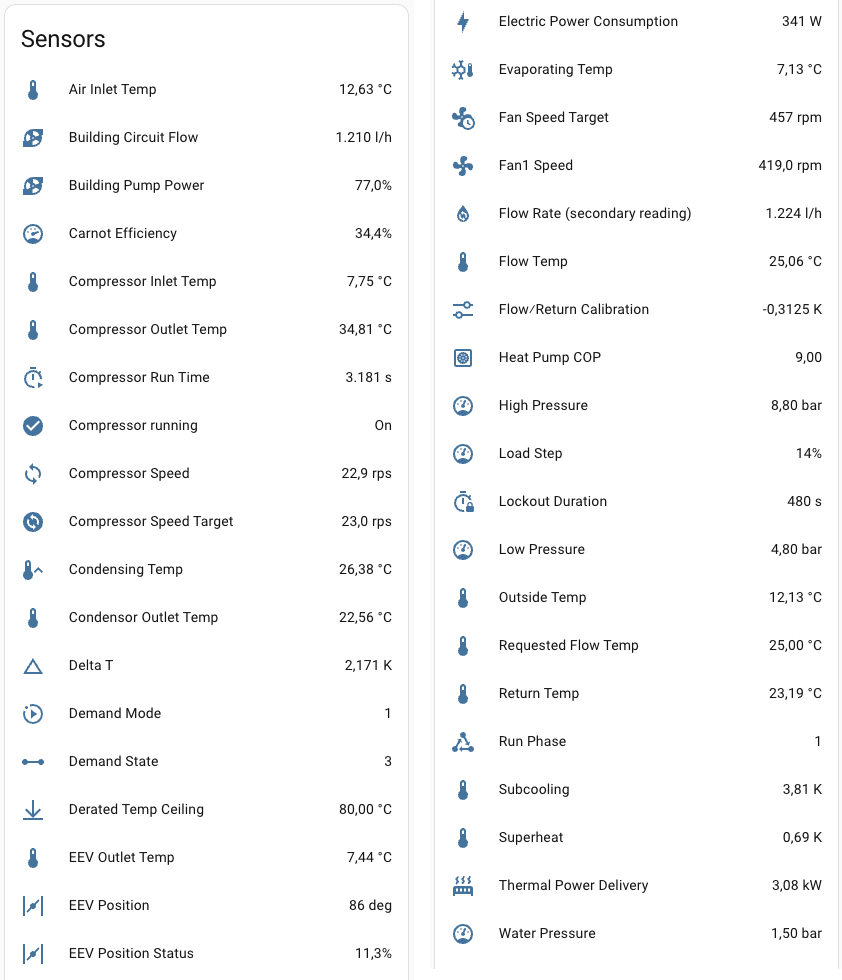

# esphome-arotherm-modbus

A passive ESP32/ESPHome component that sniffs the internal RS-485 link
between a Vaillant aroTHERM-family outdoor unit and its indoor hydraulic
station/appliance interface, and exposes the decoded readings as Home
Assistant sensors - without ever being able to write to the bus.

Confirmed against a **Vaillant VWZ AI <-> AroTHERM 75/8.1** installation
(the same physical link Vaillant also uses on aroTHERM split/split plus
units - see "Which heat pumps this applies to" below). The bus turned out
to be genuine Modbus RTU carrying Vaillant's own register map, not eBUS.

Also reported working on:

- **aroTHERM plus 7 kW <-> VWZ AI** ([#2](https://github.com/thoutenbos/esphome-arotherm-modbus/issues/2)) -
  reads one extra register in the `0x2000` block (35 instead of 34).
- **aroTHERM Split plus: outdoor unit VWL 75/8.2 <-> indoor unit VWL 77/8.2 IS**
  ([#3](https://github.com/thoutenbos/esphome-arotherm-modbus/pull/3)) -
  shorter blocks, and the building circuit flow lives in a different
  register. See "Differences between units" below for the config changes.

> **[`REGISTERS.md`](REGISTERS.md)**: one table per
> register block, every register's known identity/scale/`ebusd` mapping or
> an explicit "unknown," covering the complete 271-register structure, not
> just the 53 currently published as sensors - plus the machine's state
> machines and sequences (start, stop, mode change, defrost) and the
> formulas behind the derived registers. This file covers the hardware,
> wiring, installation and the published sensors. What changed between
> releases is in [`CHANGELOG.md`](CHANGELOG.md).

## Which heat pumps this applies to

Vaillant's older/other generations run **eBUS** (different electrical
characteristics than RS-485) between the outdoor unit and the indoor
hydraulic station - the active open-source decoder for that is
[ebusd](https://github.com/john30/ebusd) +
[ebusd-configuration](https://github.com/john30/ebusd-configuration), and
this component's own protocol identification leans on `ebusd`'s field
definitions for cross-reference.

The **newer generation** moved specifically the outdoor-compressor <->
indoor-hydraulic-station link off eBUS and onto this Modbus RTU link
instead.

No public register map for this link could be found before this project 
- if you have a similar unit and want to help extend the register map, see
[`CONTRIBUTING.md`](CONTRIBUTING.md).

## Why it's passive

Three independent layers, any one of which alone is enough:

1. **Hardware**: the RS-485 transceiver's TX pin is not connected
   to the ESP32 board.
2. **UART config**: the component configures its hardware UART itself
   with only an `rx_pin` - it never calls `uart_set_pin()` with a TX pin,
   so the ESP32 UART peripheral has no pin to drive even in software.
3. **Firmware**: this component only ever reads its hardware UART's
   receive FIFO. It has no write path at all, on any pin.

Tap the sniffer's A/B leads directly across the existing bus wiring (e.g.
at a spare screw terminal, or in parallel with an existing device's A/B
pins). Don't add termination resistors at the sniffer - it's a tap, not a
bus endpoint, and adding termination there would load the bus.

If the bus carries mains-adjacent voltages or you want extra peace of
mind, use an opto-isolated RS-485 module instead of a bare MAX485
breakout.

## Hardware

- Any ESP32 dev board
- An RS-485-to-TTL transceiver breakout (MAX485, MAX3485, SP3485, or an
  opto-isolated module)

Wiring:

| RS-485 module | ESP32 |
|---|---|
| A | bus A |
| B | bus B |
| RO | ESP32 GPIO21 |
| DE + RE | GND (tied together, permanently) |
| DI | not connected |

`rx_pin: 21` in the example config matches this; any input-capable ESP32
pin works if you wire elsewhere.

## Installation

1. Copy [`arotherm-modbus.yaml`](arotherm-modbus.yaml) into
   your own ESPHome config directory and fill in your own `secrets.yaml`
   (`wifi_ssid`, `wifi_password`, `api_encryption_key`, an OTA password).
2. The `external_components:` block already points at this repository -
   pin `ref:` to a release tag once one exists, rather than tracking
   `main`, so an upstream change can't surprise a working install.
3. Flash: `esphome run arotherm-modbus.yaml` (first flash needs a USB
   cable; subsequent updates go out over Wi-Fi/OTA).
4. Add the device in Home Assistant via the ESPHome integration as usual -
   it will expose the register-decoded sensors below plus 2 calculated
   sensors. Every sensor publishes nothing until a matching message has
   actually been seen since boot - no data right after a fresh flash is
   expected, not a fault.

## Decoded fields

The firmware validates every reassembled message against the standard
Modbus RTU CRC-16 and decodes it by function code. A write request names its
own start register; a read response does not, so it is attributed to the
read request seen just before it (start register and count). Only when no
matching request was seen - right after boot, or if the request was lost -
does it fall back to the VWZ AI block lengths (34 -> `0x2000`, 98 ->
`0x2100`, 73 -> `0x2200`), and a response that matches neither is dropped.

Each register is a big-endian 16-bit word, read as a signed integer unless
the table says *unsigned* (timers and powers that run past 32,767) and then
scaled: D2C `raw / 16` for temperatures, `/10`, `/50` (volts), `/1000`
(amps). Three values are 32-bit IEEE-754 floats (big-endian, high word
first) spanning a register and the one after it, and are only published
when both halves are in the block and the value is finite. Three registers
are published as text.



*(Screenshot from an earlier version; the sensor list below is current.)*

53 sensors: 50 numeric and 3 text. Every register is described in
[`REGISTERS.md`](REGISTERS.md), which also explains the sequences the state
sensors step through.

**Temperatures and the water-side differential**

| HA sensor | register | notes |
|---|---|---|
| `Air Inlet Temp` | `0x200B` | °C, D2C. The air the evaporator actually sees |
| `Outside Temp` | `0x1009` (write) | °C, D2C. The controller's damped outside temperature |
| `Flow Temp` | `0x200C` | °C, D2C. After the machine's flow/return calibration - see `Delta T` |
| `Return Temp` | `0x200D` | °C, D2C. After the flow/return calibration |
| `Delta T` | `0x2209`:`0x220A` (float) | K - the machine's own flow-minus-return *before* its calibration: `delta_t - (flow_temp - return_temp) = -flow_return_calibration`. Within 0.012 K of an MID-certified heat meter, where the calibrated pair reads up to 14% low at small differentials. Continuous rather than in 1/16 K steps |
| `Requested Flow Temp` | `0x1019` (write) | °C, D2C. A fixed hot-water setpoint under hot water; the weather-compensated, modulated setpoint under space heating; while idle a weather-dependent value that is *not* the heating curve. Not on the aroTHERM Split plus |
| `Flow-Return Calibration` | `0x1109` (write) | K, D2C (signed `raw / 16`) - Vaillant's D.003 (`CalibrationVLRL` in `ebusd`, which prints the raw count). The machine sets it itself and it can change: it has been seen to step `0` -> `-1` -> `-4` -> `-5` (-0.3125 K) within weeks |

**Refrigerant circuit**

| HA sensor | register | notes |
|---|---|---|
| `Compressor Inlet Temp` | `0x2007` | °C, D2C |
| `Compressor Outlet Temp` | `0x2008` | °C, D2C. A pipe temperature downstream of the compressor, not the discharge gas - it peaks in the mid-50s °C on a hot-water charge |
| `EEV Outlet Temp` | `0x2009` | °C, D2C |
| `Condensor Outlet Temp` | `0x200A` | °C, D2C |
| `Condensing Temp` | `0x2126` | °C, D2C. `condensing - condensor_outlet` equals `Subcooling` exactly |
| `Evaporating Temp` | `0x2128` | °C, D2C. `compressor_inlet - evaporating` equals `Superheat` exactly; drives the frost model |
| `High Pressure` | `0x200F` | bar, `/10` |
| `Low Pressure` | `0x200E` | bar, `/10` |
| `Subcooling` | `0x212A` | K, D2C. The variable the expansion valve controls on this machine |
| `Superheat` | `0x212C` | K, D2C. Sits just above 0 K by design (its setpoint is 0), so near zero is not a fault |
| `EEV Position` | `0x2120` | steps, raw (absolute valve opening; 250 at rest, 525 is the end stop) |
| `EEV Position Status` | `0x212D` | %, `/10` |
| `Derated Temp Ceiling` | `0x2137` | °C, D2C. 80.00 °C, lowered along two straight segments once the evaporating temperature is below -5 °C (78 °C at -20 °C, 70 °C at about -24 °C). Which temperature it caps is not established |

**Compressor and fan**

| HA sensor | register | notes |
|---|---|---|
| `Compressor Speed` | `0x2010` | rps, `/10` - measured |
| `Compressor Speed Target` | `0x2122` | rps, `/10` - commanded; leads the measured speed |
| `Compressor Speed Min` | `0x2003` | rps, `/10` - the lower bound of the permitted speed, the modulation floor: 30 rps at or below about 5 °C air inlet, 20 rps in mild weather. `0` (window closed) when idle, in the pre-run and during a defrost |
| `Compressor Speed Max` | `0x2002` | rps, `/10` - the upper bound: 120 rps in the cold, falling in milder air. Fixed at 50-60 rps for 180 s after every start and 30-50 rps around a heating/hot-water changeover |
| `Compressor Slew Limit` | `0x213F`:`0x2140` (float) | rps/s - how fast the speed target may move: 2.0 when idle, for 180 s after a start, around a changeover and through a defrost; 0.2 in free modulation |
| `Compressor Speed Stable Time` | `0x2145` | s, unsigned - seconds since the compressor speed last moved more than 3% (cumulative band). The frost model waits on it |
| `Compressor Ramp State` | `0x214E` | **text**: `Off`, `Starting`, `At speed`, `Ramping up`, `Ramping down`, `Ramping down to stop` (any other bit pattern is spelled out bit by bit). Published on change only |
| `Fan1 Speed` | `0x2011` | rpm, raw - measured |
| `Fan Speed Target` | `0x2123` | rpm, raw - commanded; leads the measured speed by 1-2 polls |
| `Fan Target Stable Time` | `0x2146` | s, unsigned - seconds since the fan speed target last moved more than 3%. Runs whenever the fan target is set |

**Water side**

| HA sensor | register | notes |
|---|---|---|
| `Water Pressure` | `0x2013` | bar, `/10` |
| `Building Circuit Flow` | `0x2014` | l/h, raw. The flow sensor; within 2% of an MID-certified heat meter in every mode. Always `0` on the Split plus |
| `Building Circuit Flow (Split)` (`building_circuit_flow_split`) | `0x100A` (write) | l/h, raw. An exact echo of `0x2014` on the VWZ AI; the only flow reading on the aroTHERM Split plus |
| `Building Circuit Flow Target` | `0x2001` | l/h, raw - the flow the outdoor unit asks for: 1205 l/h whenever a demand is active, `0` otherwise. With the pump at 100% a restrictive circuit can fall short of it |
| `Building Pump Power` | `0x1003` (write) | %, `/10` - the pump command |
| `Heat Output` | `0x1014` (write) | W, unsigned - the heat output the controller computes from flow and the *calibrated* flow/return pair, and the input to the outdoor unit's defrost decision. Inherits the calibration offset, so it reads low at small differentials (18-19% at 1.8 K with a -0.3125 K offset). Non-zero only while the compressor runs |
| `Hot Water Mode Active` | `0x1012` (write) | `1` while the outdoor unit is in hot-water mode; its edges are the moment the diverter valve moves |

**Electrical**

| HA sensor | register | notes |
|---|---|---|
| `Electric Power Consumption` | `0x211B` | W, raw. Reads low against a separate electricity meter by a near-constant ratio - about 4.7% at normal load, about 7% when heavily throttled. 6-8 W in standby |
| `Mains Voltage` | `0x201B` | V, `/50` (1 V resolution). Within 0.2 V of a separate mains voltage sensor. `0` while the drive sleeps, from 480 s after a stop until the next start |
| `Mains Current` (`active_current`) | `0x201C` | A, `/1000` - power over voltage, rounded up to the next 0.1 A. `0` while the drive sleeps |

**Demand and state**

| HA sensor | register | notes |
|---|---|---|
| `Demand Mode` | `0x1000` (write) | the controller's command: `0` idle, `1` space heating, `2` hot water, `5` defrost (initiated by the outdoor unit and acknowledged by the controller) |
| `Demand State` | `0x2144` | the outdoor unit's demand and defrost state machine: `0` idle, `1` pre-run (60 s of pump and fan before the compressor), `3` running, `4` fan run-on after a stop (64 s, or 604 s at an air inlet of about 6 °C or below), and `5` `6` `7` `8` `9` `11` for the stages of a defrost. Both demand edges land within a second of the `Demand Mode` write |
| `Run Phase` | `0x2015` | `0` idle, `1` a heating or hot-water episode in progress, `6` post-episode lockout. Holds `1` across many demand cycles inside one long heating call, so it does **not** mean the compressor is running - use `Demand Mode`, `Demand State` or `Compressor Speed` for that |
| `Demand Window` | `0x215C` | `150` from the start hand-off until 482 s after the compressor stops, else `0` |
| `Lockout Duration` | `0x221D`:`0x221E` (float) | s - a stored `480.0`: after the compressor stops, the drive sleeps and `Run Phase` unwinds only after this long. A floor on the off time between cycles |

**Defrost**

| HA sensor | register | notes |
|---|---|---|
| `Defrost Sequence` | `0x2006` | `1` for the **whole** defrost, from preparation to recovery (`Demand State` `5` to `11`): the window in which heat is taken out of the house, and the one to drive an automation off |
| `Defrost Active` | `0x2131` | `1` only while the refrigerant circuit is reversed (`Demand State` `6` to `8`) |
| `Defrost Capacity Loss` | `0x2160`:`0x2161` (float) | % - `100 x (1 - Heat Output / Defrost Reference Heat Output)`. **A defrost is commanded once this has been at or above 15 for 60 s.** Negative values are real (output above the reference); frozen for 300 s after a compressor speed change; `0` while the coil is above freezing |
| `Defrost Reference Heat Output` | `0x2147` | W, unsigned - the clean-coil reference: the mean `Heat Output` over 180 s of steady compressor speed, taken once the frost model is live, then rescaled with compressor speed |
| `Defrost Reference Attempt` | `0x2148` | which attempt at taking that reference this is; `1` means the first try, values up to 4 have been seen. `0` until 600 s after the previous defrost |
| `Time Since Defrost` | `0x214C` | s, unsigned - since the last defrost ended. A reset to `0` marks a defrost. It does not wrap: 18.2 h after a defrost it reaches 65,535 and drops to `0`, so `0` also means "none in the last 18 hours" |

The full defrost sequence and the frost model that decides it are described
in [`REGISTERS.md`](REGISTERS.md) sections 5.6 and 5.7.

**Identity**

| HA sensor | register | notes |
|---|---|---|
| `Serial Number` | `0x1203`-`0x1214` (write) | **text** - the unit's 28-character serial number |
| `Firmware Version` | `0x2203`-`0x2205` | **text** - `major.minor.patch` |

Temperatures use eBUS's D2C convention (`degrees C = raw / 16`, signed
16-bit big-endian) - the same fixed-point convention eBUS uses, even
though the framing around it is genuine Modbus, not eBUS-derived.

### Differences between units

The register *layout* is the same on every unit seen so far; what differs is
how many registers each block carries, and on the split unit which side
owns the water circuit:

| block | VWZ AI + aroTHERM 75/8.1 | VWZ AI + aroTHERM plus 7 kW | aroTHERM Split plus (VWL 75/8.2 + VWL 77/8.2 IS) |
|---|---|---|---|
| write `0x1000` | 26 | 26 | 25 |
| write `0x1100` | 15 | 15 | 14 |
| write `0x1200` | 25 | 25 | 24 |
| read `0x2000` | 34 | 35 | 32 |
| read `0x2100` | 98 | 98 | 98 |
| read `0x2200` | 73 | 73 | 73 |

Because read responses are attributed to their request, the different
lengths need no configuration. On an **aroTHERM Split plus**, leave out
`water_pressure` (`0x2013` reads `0xFFFF`), `building_circuit_flow`
(`0x2014`, always 0), `run_phase` (`0x2015`, 0 even with the compressor
running) and `requested_flow_temp` (`0x1019`, beyond the 25-register write
block), and use `building_circuit_flow_split` instead - see the commented
block in [`arotherm-modbus.yaml`](arotherm-modbus.yaml).

The register map was built on the VWZ AI + aroTHERM 75/8.1. On the other
units only the basic temperatures, pressures, speeds, power and flow have
been checked, and on the aroTHERM plus 7 kW the `Delta T` identity; treat
the rest as unverified there - reports either way are welcome.

### Calculated values

Two more sensors are computed entirely in ESPHome
(`platform: template` in the example config), not decoded from any
register:

- `Heat Pump COP` - `Heat Output` divided by `Electric Power Consumption`.
  Unavailable (rather than `0`) while the compressor is stopped or below
  50 W electric draw, so idle time does not drag averages and long-term
  statistics down.
- `Carnot Efficiency` (%) - `Heat Pump COP` as a fraction of the Carnot
  COP between the mean of flow and return and the air inlet temperature.
  That takes the weather and the flow temperature out of the figure and
  leaves the machine's own quality; real air-source units sit around
  30-50%.

Both inherit the biases of their inputs, which partly cancel: `Heat Output`
reads low at small flow/return differentials (see its row), and `Electric
Power Consumption` reads about 5-7% low. They are good for comparing one
cycle or operating point with another, not a number to quote against a
manufacturer's COP or a billed figure. For an independent heat figure,
`Building Circuit Flow x Delta T x 4.186 / 3600` (kW, pure water) avoids
the calibration offset.

### What's not decoded yet

271 registers exist across six blocks on the VWZ AI; 53 sensors are
published from them (one, `building_circuit_flow_split`, mainly for the
Split plus). The rest are echoes of an already-published register,
constants and placeholders, static identity or configuration, a lead not
yet solid enough to publish, or genuinely unknown - see `REGISTERS.md` for
the complete register-by-register breakdown and its list of open
questions. If you have a similar unit and want to help narrow these down,
see [`CONTRIBUTING.md`](CONTRIBUTING.md).

## Reading the debug log

Raw message logging stays on regardless of what's decoded as a sensor -
every reassembled, CRC-valid message is logged at `DEBUG` with its hex
dump and, for every write request and every read response that follows its
own request, a full per-register dump (`regs=[2000=0000(0.00) ...]`, each
value also shown at the D2C `/16` scale).

The `0x1200` write block and the `0x2200` read block carry the indoor and
outdoor units' serial numbers as ASCII, so a debug log contains them in
clear text (in the hex dump and the `ascii=[...]` field), and the
`Serial Number` sensor publishes it to Home Assistant -
leave it out of your config if you would rather not have it there. Scrub
serial numbers before posting a log publicly - [`tests/tools/import_capture.py`](tests/tools/import_capture.py)
does that for you.

## Testing

[`tests/`](tests/README.md) has a host-side test suite that compiles the
real component C++ with stand-in ESPHome headers and replays real bus
captures through it - framing, CRC, decoding and the debug log - against an
independent Python reference decoder. It needs only Python 3 and g++/clang++:

```
python3 tests/run_tests.py
```

It runs on every push and pull request (GitHub Actions), together with
`esphome config` on the example configuration.

## License

[GPL-3.0](LICENSE).
