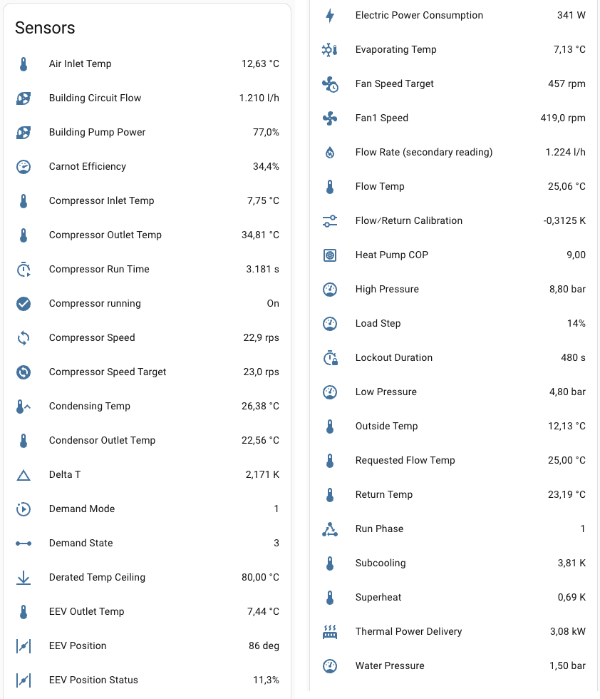

# esphome-arotherm-modbus

A passive ESP32/ESPHome component that sniffs the internal RS-485 link
between a Vaillant aroTHERM-family outdoor unit and its indoor hydraulic
station/appliance interface, and exposes the decoded readings as Home
Assistant sensors - without ever being able to write to the bus.

Confirmed against a **Vaillant VWZ AI <-> AroTHERM 75/8.1** installation
(the same physical link Vaillant also uses on aroTHERM split/split plus
units - see "Which heat pumps this applies to" below). The bus turned out
to be genuine Modbus RTU carrying Vaillant's own register map, not eBUS.

Also reported working on:

- **aroTHERM plus 7 kW <-> VWZ AI** ([#2](https://github.com/thoutenbos/esphome-arotherm-modbus/issues/2)) -
  reads one extra register in the `0x2000` block (35 instead of 34).
- **aroTHERM Split plus: outdoor unit VWL 75/8.2 <-> indoor unit VWL 77/8.2 IS**
  ([#3](https://github.com/thoutenbos/esphome-arotherm-modbus/pull/3)) -
  shorter blocks, and the building circuit flow lives in a different
  register. See "Differences between units" below for the config changes.

> **[`REGISTERS.md`](REGISTERS.md)**: one table per
> register block, every register's known identity/scale/`ebusd` mapping or
> an explicit "unknown," covering the complete 271-register structure, not
> just the 36 currently published as sensors. This file covers the
> hardware, wiring, and installation.

## Which heat pumps this applies to

Vaillant's older/other generations run **eBUS** (different electrical
characteristics than RS-485) between the outdoor unit and the indoor
hydraulic station - the active open-source decoder for that is
[ebusd](https://github.com/john30/ebusd) +
[ebusd-configuration](https://github.com/john30/ebusd-configuration), and
this component's own protocol identification leans on `ebusd`'s field
definitions for cross-reference.

The **newer generation** moved specifically the outdoor-compressor <->
indoor-hydraulic-station link off eBUS and onto this Modbus RTU link
instead.

No public register map for this link could be found before this project 
- if you have a similar unit and want to help extend the register map, see
[`CONTRIBUTING.md`](CONTRIBUTING.md).

## Why it's passive

Three independent layers, any one of which alone is enough:

1. **Hardware**: the RS-485 transceiver's TX pin is not connected
   to the ESP32 board.
2. **UART config**: the component configures its hardware UART itself
   with only an `rx_pin` - it never calls `uart_set_pin()` with a TX pin,
   so the ESP32 UART peripheral has no pin to drive even in software.
3. **Firmware**: this component only ever reads its hardware UART's
   receive FIFO. It has no write path at all, on any pin.

Tap the sniffer's A/B leads directly across the existing bus wiring (e.g.
at a spare screw terminal, or in parallel with an existing device's A/B
pins). Don't add termination resistors at the sniffer - it's a tap, not a
bus endpoint, and adding termination there would load the bus.

If the bus carries mains-adjacent voltages or you want extra peace of
mind, use an opto-isolated RS-485 module instead of a bare MAX485
breakout.

## Hardware

- Any ESP32 dev board
- An RS-485-to-TTL transceiver breakout (MAX485, MAX3485, SP3485, or an
  opto-isolated module)

Wiring:

| RS-485 module | ESP32 |
|---|---|
| A | bus A |
| B | bus B |
| RO | ESP32 GPIO21 |
| DE + RE | GND (tied together, permanently) |
| DI | not connected |

`rx_pin: 21` in the example config matches this; any input-capable ESP32
pin works if you wire elsewhere.

## Installation

1. Copy [`arotherm-modbus.yaml`](arotherm-modbus.yaml) into
   your own ESPHome config directory and fill in your own `secrets.yaml`
   (`wifi_ssid`, `wifi_password`, `api_encryption_key`, an OTA password).
2. The `external_components:` block already points at this repository -
   pin `ref:` to a release tag once one exists, rather than tracking
   `main`, so an upstream change can't surprise a working install.
3. Flash: `esphome run arotherm-modbus.yaml` (first flash needs a USB
   cable; subsequent updates go out over Wi-Fi/OTA).
4. Add the device in Home Assistant via the ESPHome integration as usual -
   it will expose the register-decoded sensors below plus 3 calculated
   sensors. Every sensor publishes nothing until a matching message has
   actually been seen since boot - no data right after a fresh flash is
   expected, not a fault.

## Decoded fields

The firmware validates every reassembled message against the standard
Modbus RTU CRC-16 and decodes it by function code. A write request names its
own start register; a read response does not, so it is attributed to the
read request seen just before it (start register and count). Only when no
matching request was seen - right after boot, or if the request was lost -
does it fall back to the VWZ AI block lengths (34 -> `0x2000`, 98 ->
`0x2100`, 73 -> `0x2200`), and a response that matches neither is dropped.

Almost every register is a signed 16-bit value. The exceptions are two
32-bit IEEE-754 floats (big-endian, high word first) that span a register
and the one after it - `delta_t` at `0x2209` and `lockout_duration` at
`0x221D`. A float is only published when both halves are in the block and
it decodes to a finite number.



| HA sensor | register | notes |
|---|---|---|
| `Compressor Inlet Temp` | `0x2007` | °C, D2C (`raw / 16`) |
| `Compressor Outlet Temp` | `0x2008` | °C, D2C. A pipe temperature downstream of the compressor rather than the discharge gas itself - it tops out in the mid-50s °C even on a hot-water charge |
| `EEV Outlet Temp` | `0x2009` | °C, D2C |
| `Condensor Outlet Temp` | `0x200A` | °C, D2C |
| `Air Inlet Temp` | `0x200B` | °C, D2C |
| `Flow Temp` | `0x200C` | °C, D2C. Carries the machine's flow/return calibration - see `Delta T` |
| `Return Temp` | `0x200D` | °C, D2C |
| `Outside Temp` | `0x1009` (write block `0x1000`) | °C, D2C |
| `High Pressure` | `0x200F` | bar, `raw / 10` |
| `Water Pressure` | `0x2013` | bar, `raw / 10` |
| `Low Pressure` | `0x200E` | bar, `raw / 10` |
| `Compressor Speed` | `0x2010` | rps, `raw / 10` - the heat pump's actual, real-time speed |
| `Compressor Speed Target` | `0x2122` | rps, `raw / 10` - the *commanded* speed; snaps to a new value instantly on a demand start/stop, while Compressor Speed only catches up over the following several seconds |
| `Compressor Run Time` | `0x2146` | s, raw integer - seconds since the compressor started, `0` while it is stopped. Matches the wall clock to within half a second over multi-hour runs on the VWZ AI + aroTHERM 75/8.1; on the aroTHERM plus 7 kW dump from [#2](https://github.com/thoutenbos/esphome-arotherm-modbus/issues/2) it counts up while stopped, so it may mean something different there |
| `Fan1 Speed` | `0x2011` | rpm, raw integer |
| `Fan Speed Target` | `0x2123` | rpm, raw integer - sits just above the measured fan speed and leads it, so it reads as the commanded fan speed (**lead**, not confirmed) |
| `Building Pump Power` | `0x1003` (write block `0x1000`) | %, `raw / 10` |
| `EEV Position` | `0x2120` | degrees, raw integer (absolute valve opening) |
| `EEV Position Status` | `0x212D` | %, `raw / 10` - distinct from EEV Position |
| `Subcooling` | `0x212A` | K, D2C (a temperature *difference*). The variable the expansion valve controls on this machine |
| `Superheat` | `0x212C` | K, D2C. Sits just above 0 K by design (its setpoint is 0), so a near-zero value is not a fault |
| `Condensing Temp` | `0x2126` | °C, D2C - saturation temperature on the high side. Proved by identity: `condensing - condensor_outlet` equals `subcooling` exactly |
| `Evaporating Temp` | `0x2128` | °C, D2C - saturation temperature on the low side, the frost signal. Proved by identity: `compressor_inlet - evaporating` equals `superheat` |
| `Derated Temp Ceiling` | `0x2137` | °C, D2C - pinned at exactly 80.00 °C, and lowered slightly (about `80 + 0.069 x evaporating_temp`) only once the evaporator drops below about -2 °C. Which temperature it caps is not established (**lead**) |
| `Electric Power Consumption` | `0x211B` | W, raw integer. 6-8 W in standby. Checked against an independent electricity meter on the outdoor unit's supply it reads **low** by a near-constant *ratio* - about 4.7% at normal load, widening to about 7% when the unit is heavily throttled - so budget for that in anything computed from it |
| `Load Step` | `0x201C` | %, `raw / 100` - an integer percentage in 1% steps, 0-101. What it is a percentage *of* is not established (**lead**) |
| `Building Circuit Flow` | `0x2014` | l/h, raw integer. Tracks an independent certified heat meter to within 1%. Always `0` on the aroTHERM Split plus - use `building_circuit_flow_split` there |
| `Building Circuit Flow (Split)` (`building_circuit_flow_split`) | `0x100A` (write block `0x1000`) | l/h, raw integer. An exact echo of `0x2014` on the VWZ AI; the only flow reading on the aroTHERM Split plus, where the indoor unit owns the flow meter |
| `Flow Rate (secondary reading)` (`flow_rate_secondary`) | `0x2020` | l/h, raw integer - a second flow-shaped reading whose meaning is **not** established. `0` whenever the pump is stopped; otherwise `building_circuit_flow` times a factor that switches with the diverter valve (~1.038 under space heating, ~0.97 under hot water). Use `Building Circuit Flow` for the real flow. Not in the Split plus `0x2000` block |
| `Delta T` | `0x2209`:`0x220A` (32-bit float) | K - the heat pump's own flow-minus-return differential, *before* its flow/return calibration: `delta_t - (flow_temp - return_temp) = -flow_return_calibration`. Continuous rather than in 1/16 K steps, and the better figure of the two: against a certified heat meter it was within about -0.6%, where `flow_temp - return_temp` read about 14% low at minimum modulation. The identity was also checked on the aroTHERM plus 7 kW dump from #2 |
| `Flow/Return Calibration` | `0x1109` (write block `0x1100`) | K, D2C (signed `raw / 16`) - Vaillant's D.003, `CalibrationVLRL` in `ebusd`. The machine writes it itself, it is not an installer setting, and it can change: it has been seen to step from `0` to `-1`, `-4` and `-5` within a few weeks of the heating season starting. Note `ebusd` prints the raw value (`-5 K`) where the machine means `-0.3125 K` |
| `Demand Mode` | `0x1000` (write block `0x1000`, offset 0) | not telemetry - the controller's own on/off command. `0`=idle, `1`=space heating, `2`=domestic hot water. Hot water asks for a fixed 80 °C flow and holds the compressor near 60 rps; space heating modulates and can run it close to 96 rps |
| `Demand State` | `0x2144` | raw integer - the outdoor unit's demand state machine: `0` idle -> `1` the instant a demand asserts -> `3` running -> `4` the instant it clears -> `0`. Both edges land within a second of the `demand_mode` write - the sharpest demand-edge marker on the bus |
| `Requested Flow Temp` | `0x1019` (write block `0x1000`) | °C, D2C - the flow-temperature setpoint bundled with the demand command above. A fixed 80 °C under hot water; under space heating it starts high and then modulates with the heating circuit; while idle it follows a weather-dependent value that is *not* the heating curve. Not present on the aroTHERM Split plus (its `0x1000` block ends at `0x1018`) |
| `Run Phase` | `0x2015` | raw integer - the heat pump's episode state (`0`=idle, `1`=active, `6`=post-stop lockout). A demand starts a ~60 s pump-and-fan prerun before the compressor is commanded, so this leads the compressor by about a minute. It holds `1` through many `demand_mode` cycles inside one long heating call, so do **not** use it as "compressor running" - use `demand_mode` or `compressor_speed` |
| `Lockout Duration` | `0x221D`:`0x221E` (32-bit float) | s - a stored `480.0`: the post-stop lockout during which `run_phase` sits at `6` with compressor, fan and pump all off. Timed from the compressor reaching 0 rps it measures 480-482 s. A floor on the off time between two cycles |

Temperatures are eBUS's D2C convention (`degrees C = raw / 16`, signed
16-bit big-endian) - the same fixed-point convention eBUS uses, even
though the framing around it is genuine Modbus, not eBUS-derived.

### Differences between units

The register *layout* is the same on every unit seen so far; what differs is
how many registers each block carries, and on the split unit which side
owns the water circuit:

| block | VWZ AI + aroTHERM 75/8.1 | VWZ AI + aroTHERM plus 7 kW | aroTHERM Split plus (VWL 75/8.2 + VWL 77/8.2 IS) |
|---|---|---|---|
| write `0x1000` | 26 | 26 | 25 |
| write `0x1100` | 15 | 15 | 14 |
| write `0x1200` | 25 | 25 | 24 |
| read `0x2000` | 34 | 35 | 32 |
| read `0x2100` | 98 | 98 | 98 |
| read `0x2200` | 73 | 73 | 73 |

Because read responses are attributed to their request, the different
lengths need no configuration. On an **aroTHERM Split plus**, leave out
`water_pressure` (`0x2013` reads `0xFFFF`), `building_circuit_flow`
(`0x2014`, always 0), `run_phase` (`0x2015`, 0 even with the compressor
running), `requested_flow_temp` (`0x1019`, beyond the 25-register write
block) and `flow_rate_secondary` (`0x2020`, beyond the 32-register `0x2000`
block), and give `building_circuit_flow_split` the id `building_circuit_flow`
so the calculated `Thermal Power Delivery` / `Heat Pump COP` keep working -
see the commented block in [`arotherm-modbus.yaml`](arotherm-modbus.yaml).

The sensors added from the `0x2100`, `0x2200` and `0x1100` blocks
(`condensing_temp` onward in the table above) were identified on the VWZ AI
+ aroTHERM 75/8.1. Except where a row says it was also checked on another
unit, treat them as unverified elsewhere - reports either way are welcome.

### Calculated values

Three more sensors are computed entirely in ESPHome
(`platform: template` in the example config), not decoded from any
register:

- `Thermal Power Delivery` (kW) - `building_circuit_flow x delta_t x 4.186
  / 3600`, the standard sensible-heat formula (assumes pure water, not a
  glycol mix). It uses `delta_t` rather than `flow_temp - return_temp`,
  because the calibrated pair under-reads by `flow_return_calibration`; it
  falls back to the pair until `delta_t` has been seen.
- `Heat Pump COP` - thermal power delivered divided by electric power
  consumption. Unavailable (rather than `0`) while the compressor is
  stopped or below 50 W electric draw, so idle time does not drag averages
  and long-term statistics down.
- `Carnot Efficiency` (%) - `Heat Pump COP` as a fraction of the Carnot
  COP between the mean of flow and return and the air inlet temperature.
  That takes the weather and the flow temperature out of the figure and
  leaves the machine's own quality; real air-source units sit around
  30-50%.

Because `Electric Power Consumption` reads low against a real meter (see
its row above), `Heat Pump COP` and `Carnot Efficiency` are optimistic by
the same margin - about 5% at normal load and about 7% when the unit is
throttled hard. The bias is a near-constant ratio, so they are good for
comparing one cycle or operating point with another, but not a number to
quote against a manufacturer's COP or a billed figure.

### What's not decoded yet

271 registers exist across six blocks on the VWZ AI; 36 sensors above are
published from them (one, `building_circuit_flow_split`, mainly for the
Split plus).
The rest are either confirmed structural facts with no physical quantity
to publish (echoes of an already-published register, placeholders, a
static identity/config readback), a lead not yet solid enough to trust,
or genuinely unknown - see `REGISTERS.md` for the complete register-by-
register breakdown, including exact value ranges observed for every
still-unidentified register. If you have a similar unit and want to help
narrow these down, see [`CONTRIBUTING.md`](CONTRIBUTING.md).

## Reading the debug log

Raw message logging stays on regardless of what's decoded as a sensor -
every reassembled, CRC-valid message is logged at `DEBUG` with its hex
dump and, for every write request and every read response that follows its
own request, a full per-register dump (`regs=[2000=0000(0.00) ...]`, each
value also shown at the D2C `/16` scale).

The `0x1200` write block and the `0x2200` read block carry the indoor and
outdoor units' serial numbers as ASCII, so a debug log contains them in
clear text (in the hex dump and the `ascii=[...]` field). Scrub them before
posting a log publicly - [`tests/tools/import_capture.py`](tests/tools/import_capture.py)
does that for you.

## Testing

[`tests/`](tests/README.md) has a host-side test suite that compiles the
real component C++ with stand-in ESPHome headers and replays real bus
captures through it - framing, CRC, decoding and the debug log - against an
independent Python reference decoder. It needs only Python 3 and g++/clang++:

```
python3 tests/run_tests.py
```

It runs on every push and pull request (GitHub Actions), together with
`esphome config` on the example configuration.

## License

[GPL-3.0](LICENSE).
